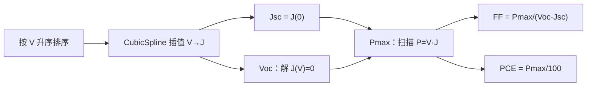

# pv_extractor · 光伏 J-V 曲线参数提取

> 用单二极管模型造一条 J-V 曲线，再用三次样条插值和求根，把 **Jsc / Voc / Pmax / FF / PCE** 反推回来。

这是一个使用函数模拟出的**练习项目**：目的不是测真实器件，然后把「造数据 → 插值 → 求根 → 提参数 → 出汇总表」这条链路完整走一遍。

## 目录

- [提取哪些参数](#提取哪些参数)
- [原理](#原理)
- [结果](#结果)
- [仓库结构](#仓库结构)
- [快速开始](#快速开始)
- [换成自己的数据](#换成自己的数据)
- [已知问题与改进方向](#已知问题与改进方向)

## 提取哪些参数

| 参数 | 含义 | 求解方法 | 单位 |
|---|---|---|---|
| `Jsc` | 短路电流密度 | 在 `V=0` 处对 J-V 曲线插值 | mA/cm² |
| `Voc` | 开路电压 | 解方程 `J(V)=0` | V |
| `Pmax` | 最大输出功率 | 在 `[Vmin, Voc]` 上取 1000 点算 `P=V·J`，取最大值 | mW/cm² |
| `FF` | 填充因子 | `Pmax / (Voc · Jsc)` | — |
| `PCE` | 光电转换效率 | `Pmax / 100`（标准光强 100 mW/cm²） | — |

## 原理

**第一步：造数据。** 用单二极管模型生成 20 条模拟曲线，每条 60 个测点，随机种子固定为 42，保证结果可复现。

```math
J(V) = J_{sc} - \frac{V_{oc}}{R_{sh}}\left(e^{V/(nV_t)} - 1\right) - \frac{V}{R_{sh}},
\qquad V_t = \frac{kT}{q}
```

| 参数 | 取值 | 说明 |
|---|---|---|
| `Jsc` | 22 ~ 26 | 每条曲线随机，mA/cm² |
| `Voc` | 1.0 ~ 1.15 | 每条曲线随机，V |
| `n` | 1.8 | 理想因子 |
| `Rsh` | 1000 | 并联电阻，Ω·cm² |
| `T` | 298 | 温度，K（`Vt` ≈ 25.7 mV） |
| 扫描范围 | `-0.1 ~ Voc+0.1` | 60 个等距点 |

**第二步：提参数。** 对每条曲线：



三次样条要求自变量严格递增，所以先 `argsort` 再插值；求根用 `scipy.optimize.fsolve`，以扫描范围内的最大电压为初值。

## 结果

20 个样品跑完后的统计（完整数据见 [`result_summary.csv`](./output/result_summary.csv)）：

| 指标 | 最小 | 平均 | 最大 |
|---|---|---|---|
| `Jsc` (mA/cm²) | 22.08 | 23.69 | 25.86 |
| `Voc` (V) | 1.107 | 1.173 | 1.246 |
| `Pmax` (mW/cm²) | 6.96 | 7.60 | 8.34 |
| `FF` | 0.253 | 0.274 | 0.293 |
| `PCE` | 6.96% | **7.60%** | 8.34% |

> ⚠️ 这些数字只用于验证流程是否跑通，**不代表真实电池效率**。

## 仓库结构

```
pv_extractor/
├── pv_extractor.ipynb        # 全部代码：生成模拟数据 → 提取参数
├── output/
│   ├── jv_data.csv           # 生成的 J-V 数据（20 样品 × 60 点 = 1200 行）
│   ├── result_summary.xlsx   # 提取结果（Excel）
│   └── result_summary.csv    # 提取结果（CSV，仓库根目录）
└── README.md
```

数据格式（`jv_data.csv`）：

| 列 | 含义 | 单位 |
|---|---|---|
| `sample_id` | 样品编号，同一条曲线共用一个值 | — |
| `V` | 电压 | V |
| `J` | 电流密度 | mA/cm² |

## 快速开始

```bash
git clone https://github.com/jiaozikeainie/pv_extractor.git
cd pv_extractor

python3 -m venv .venv
source .venv/bin/activate          # Windows: .venv\Scripts\activate
pip install numpy pandas scipy openpyxl jupyterlab

jupyter lab pv_extractor.ipynb
```

按 notebook 里的单元格顺序从上往下运行即可：先生成 `output/jv_data.csv`，再读回来提取参数，最后写出结果表。

依赖版本参考：

| 包 | 版本 |
|---|---|
| Python | 3.10 |
| numpy | 1.23 |
| pandas | 1.5 |
| scipy | 1.10 |
| openpyxl | 3.0 |

## 换成自己的数据

1. 把实测 J-V 曲线整理成和上面相同三列（`sample_id`、`V`、`J`）的 CSV；
2. 替换 `output/jv_data.csv`，或改 notebook 里 `pd.read_csv(...)` 的路径；
3. 重新运行提取部分。

注意：每条曲线至少 4 个点（三次样条的最低要求），电压可以乱序但不要有重复值。

## 已知问题与改进方向

这个项目目前还有几处明显可以改进：

1. **`Voc` 实际上取到了扫描上界。** `J` 在生成时被 `np.clip` 截断到 0，曲线末端变成一段平台；`fsolve` 从扫描上界起步，一上来就落在平台上，于是返回的就是上界本身（20 个样品全部满足 `Voc == max(V)`，误差为 0）。而模型真正的过零点在 **0.47 V** 附近。这直接导致 `FF`（0.25 左右）和 `PCE`（7% 左右）系统性偏离物理值。
   - 改进方向：求根改用 `brentq` 并限定在单调下降区间；或者生成数据时不截断；更根本的是用 `J0 = Jsc / (exp(Voc/(nVt)) - 1)` 反推饱和电流，让曲线真实的 `Voc` 等于设定值。
2. **`Rs` 是空参数。** 函数签名里有串联电阻，但没有进入电流方程。
3. **模型过于理想。** 温度固定 298 K，未考虑光强、温度系数、双二极管效应。
4. **代码全在一个 notebook 里。** 没有拆模块、没有测试，改动后无法快速回归验证。
5. **输出路径不统一。** CSV 落在根目录，XLSX 落在 `output/`。

## Roadmap

- [ ] 修正 `Voc` 求根，让 `FF` / `PCE` 回到合理量级
- [ ] 把生成与提取拆成 `src/` 模块，notebook 只负责调用和展示
- [ ] 支持读入实测 CSV，批量画 J-V 曲线和效率分布图
- [ ] 加一个最小测试，用固定数据锁定期望值，防止改坏
- [ ] 统一输出目录（全部进 `output/`）

## License

[MIT](LICENSE)
