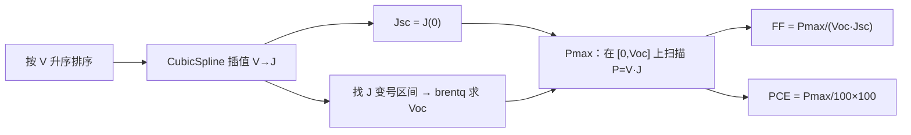

# pv_extractor · 光伏 J-V 曲线参数提取
> 用单二极管模型造一批 J-V 曲线，再用三次样条插值和求根，把 **Jsc / Voc / Pmax / FF / PCE** 反推回来。
这是一个**练习项目**：目的不是测真实器件，而是把「造数据 → 插值 → 求根 → 提参数 → 出汇总表」这条链路完整走一遍。
## 目录
- [提取哪些参数](#提取哪些参数)
- [原理](#原理)
- [结果](#结果)
- [仓库结构](#仓库结构)
- [快速开始](#快速开始)
- [换成自己的数据](#换成自己的数据)
- [已知问题与改进方向](#已知问题与改进方向)
- [更新记录](#更新记录)
## 提取哪些参数
| 参数 | 含义 | 求解方法 | 单位 |
|---|---|---|---|
| `Jsc` | 短路电流密度 | 在 `V=0` 处对 J-V 曲线插值 | mA/cm² |
| `Voc` | 开路电压 | 先找 `J` 变号的区间，再用 `brentq` 在该区间内求根 | V |
| `Pmax` | 最大输出功率 | 在 `[0, Voc]` 上取 1000 点算 `P=V·J`，取最大值 | mW/cm² |
| `FF` | 填充因子 | `Pmax / (Voc·Jsc)` | — |
| `PCE` | 光电转换效率 | `Pmax / 100 × 100`（标准光强 100 mW/cm²） | % |
## 原理
**第一步：造数据。** 用单二极管模型生成 20 条模拟曲线，每条 60 个测点，随机种子固定为 42，保证结果可复现。
```math
J(V) = J_{sc} - J_0\left(e^{V/(nV_t)} - 1\right) - \frac{V}{R_{sh}},
\qquad J_0 = \frac{J_{sc}}{e^{V_{oc}/(nV_t)} - 1}
```
| 参数 | 取值 | 说明 |
|---|---|---|
| `Jsc` | 22 ~ 26 | 每条曲线随机，mA/cm² |
| `Voc` | 1.00 ~ 1.15 | 每条曲线随机，V |
| `n` | 1.8 | 理想因子 |
| `Rsh` | 1000 | 并联电阻，Ω·cm² |
| `T` | 298 | 温度，K（`Vt` ≈ 25.7 mV） |
| 扫描范围 | `-0.1 ~ Voc+0.1` | 60 个等距点 |
> **`J0` 必须由 `Voc` 反推。** 早期版本把这一项写成了 `Voc/Rsh`，量纲对不上（V/Ω 是安培，而 `Jsc` 是 mA/cm²），曲线真正穿过 `J=0` 的位置只有约 0.47 V，跟设定的 `Voc` 完全不是一回事。改成 `J0 = Jsc/(exp(Voc/(nVt))-1)` 之后，曲线的过零点才等于设定的 `Voc`。
>
> 另外生成时**不要**对 `J` 做 `np.clip(J, 0)`：一旦截断，曲线末端会变成一段零平台，后续求根会落在这段平台上，返回的不是真正的过零点。
**第二步：提参数。** 对每条曲线：

三次样条要求自变量严格递增，所以先 `argsort` 再插值。求 `Voc` 用 `scipy.optimize.brentq`，括号取在 `J` 由正变负的那两个相邻测点之间——这样解一定落在曲线内部；早期版本用 `fsolve` 从扫描上界起步，起点正好落在零平台上，返回的就是上界本身。
## 结果
20 个样品跑完后的统计（完整数据见 [`output/result_summary.xlsx`](./output/result_summary.xlsx) 和 [`output/result_summary.csv`](./output/result_summary.csv)）：
| 指标 | 最小 | 平均 | 最大 |
|---|---|---|---|
| `Jsc` (mA/cm²) | 22.08 | 23.69 | 25.86 |
| `Voc` (V) | 1.007 | 1.073 | 1.145 |
| `Pmax` (mW/cm²) | 19.02 | 21.04 | 24.15 |
| `FF` | 0.819 | 0.827 | 0.836 |
| `PCE` | 19.02% | **21.04%** | 24.15% |
> 这些数字来自模拟曲线，只用于验证链路是否跑通，**不代表真实器件的效率**。`PCE` 的数值恰好等于 `Pmax`（单位 mW/cm²），这是 1 sun 入射功率为 100 mW/cm² 的必然结果，不是复制错误。
## 仓库结构
```
pv_extractor/
├── pv_extractor.ipynb        # 全部代码：生成模拟数据 → 提取参数
├── output/
│   ├── jv_data.csv           # 生成的 J-V 数据（20 样品 × 60 点 = 1200 行）
│   ├── result_summary.xlsx   # 提取结果（Excel）
│   └── result_summary.csv    # 提取结果（CSV）
└── README.md
```
数据格式（`jv_data.csv`）：
| 列 | 含义 | 单位 |
|---|---|---|
| `sample_id` | 样品编号，同一条曲线共用一个值 | — |
| `V` | 电压 | V |
| `J` | 电流密度 | mA/cm² |
结果表（`result_summary.*`）：
| 列 | 含义 | 单位 |
|---|---|---|
| `sample_id` | 样品编号 | — |
| `Jsc` / `Voc` | 短路电流密度 / 开路电压 | mA/cm² / V |
| `Pmax` | 最大输出功率 | mW/cm² |
| `FF` / `PCE` | 填充因子 / 效率 | — / % |
## 快速开始
```bash
git clone https://github.com/jiaozikeainie/pv_extractor.git
cd pv_extractor
python3 -m venv .venv
source .venv/bin/activate          # Windows: .venv\Scripts\activate
pip install numpy pandas scipy openpyxl jupyterlab
jupyter lab pv_extractor.ipynb
```
按 notebook 里的单元格顺序从上往下运行即可：先生成 `output/jv_data.csv`，再读回来提取参数，最后写出结果表。
依赖版本参考：
| 包 | 版本 |
|---|---|
| Python | 3.10 |
| numpy | 1.23 |
| pandas | 1.5 |
| scipy | 1.10 |
| openpyxl | 3.0 |
## 换成自己的数据
1. 把实测 J-V 曲线整理成和上面相同三列（`sample_id`、`V`、`J`）的 CSV；
2. 替换 `output/jv_data.csv`，或改 notebook 里 `pd.read_csv(...)` 的路径；
3. 重新运行提取部分。
注意：每条曲线至少 4 个点（三次样条的最低要求），电压可以乱序但不要有重复值；`J` 建议统一成正电流（V=0 处为 `Jsc`），否则要先统一符号。
## 已知问题与改进方向
1. **`Rs` 是空参数。** `single_diode_jv` 的函数签名里有串联电阻，但没有进入电流方程——真正计入它是一个关于 `J` 的隐式方程，需要迭代求解。
2. **模型过于理想。** 温度固定 298 K，未考虑光强、温度系数、双二极管效应；也没有正反扫，因此算不了迟滞（HI）。
3. **代码全在一个 notebook 里。** 没有拆模块、没有测试，改动后无法快速回归验证。
4. **还没有对接真实导出文件。** Keithley / 太阳模拟器导出的表头、单位、正反扫格式都不统一，这是下一步的主要工作量。
## Roadmap
- [x] 修正 `J0` 与 `Voc` 求根，让 `FF` / `PCE` 回到合理量级
- [ ] 支持读入实测 CSV，批量画 J-V 曲线和效率分布图
- [ ] 加串联电阻 `Rs`（隐式方程迭代）
- [ ] 把生成与提取拆成 `src/` 模块，notebook 只负责调用和展示
- [ ] 加一个最小测试，用固定数据锁定期望值，防止改坏
- [ ] 统一输出目录（全部进 `output/`）
## 更新记录
- **2026-11-21** 修正饱和电流 `J0` 的算法（改为由 `Voc` 反推）、去掉生成时的 `np.clip`、求根从 `fsolve` 改为 `brentq`。`FF` 由 0.27 回到 0.82，`PCE` 由 7.6% 回到 21.0%，`Voc` 也回到设定的 1.0–1.15 V 区间。
## License
[MIT](LICENSE)
